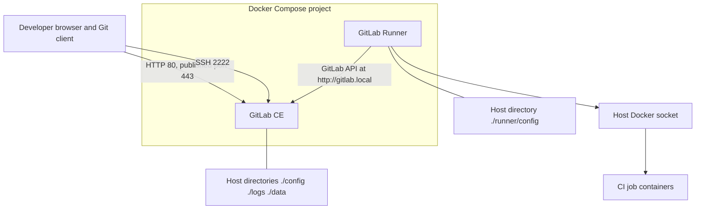

# Self-hosted GitLab CE and GitLab Runner

Docker Compose stack that runs GitLab Community Edition and a GitLab Runner. The runner image registers itself with a token you supply at runtime, then executes CI jobs with the Docker executor.

This repository is a local lab setup. It is not a hardened production install.

## Overview

`docker-compose.yml` starts two services:

- **gitlab** — `gitlab/gitlab-ce:latest`, hostname `gitlab.local`. Host ports are 80 (HTTP), 443, and 2222 (Git SSH). `external_url` is `http://gitlab.local`, so this file does not configure TLS.
- **gitlab-runner** — built from the `Dockerfile` in this repo. On start, `setup_runner.sh` writes `/etc/gitlab-runner/config.toml` from environment variables, runs `gitlab-runner register` non-interactively, then `gitlab-runner run`.

GitLab data is stored in host directories (`./config`, `./logs`, `./data`). Runner state is stored in `./runner/config`. Those paths are gitignored because they contain secrets after the first boot.

The runner authentication token and the initial root password are not stored in the repository. Copy `.env.example` to `.env` and set them there.

## Architecture



The runner process uses `GITLAB_URL` (default `http://gitlab.local`) for registration and polling. Job containers are started through the host Docker socket. The generated runner config sets `network_mode = "host"` and `extra_hosts = ["gitlab.local:172.18.0.2"]` on those jobs.

Compose DNS for the GitLab service is the service name `gitlab`. `hostname: gitlab.local` is the name inside the GitLab container. It is not, by itself, a name other containers can resolve.

## Features

- Custom runner image (`Dockerfile`) whose entrypoint is `setup_runner.sh`.
- Non-interactive registration: Docker executor, privileged mode, `docker:latest` as the default job image, tag `ci-cd`, untagged jobs allowed, runner not locked.
- Docker socket mounted into the runner (`/var/run/docker.sock`) and into jobs.
- Persistent GitLab volumes for configuration, logs, and data.
- Persistent runner config directory, recreated from environment variables on each container start.
- SSH for Git pushed to host port 2222 (`gitlab_rails['gitlab_shell_ssh_port'] = 2222`).
- Optional initial root password via `GITLAB_ROOT_PASSWORD` (first boot only).
- Optional Kubernetes notes below, taken from the project's original scratch notes. Compose does not install Helm or a Kubernetes runner.

## Tech stack

| Piece | What this repo uses |
| --- | --- |
| Orchestration | Docker Compose file format 3.8 |
| GitLab | `gitlab/gitlab-ce:latest` |
| Runner base image | `gitlab/gitlab-runner:latest` |
| Registration | Bash script, `gitlab-runner register --non-interactive` |
| CI executor | Docker executor, privileged |
| Host integration | Docker socket bind mount |
| Optional notes | Helm chart `gitlab/gitlab-runner` |

Image tags are `latest`. A pull can change GitLab or Runner behavior between starts.

## Prerequisites

- Docker Engine with the Compose plugin (`docker compose`). The legacy `docker-compose` binary works with the same file if that is what you have installed.
- Permission to talk to the Docker daemon (user in the `docker` group, or `sudo`).
- Free host ports **80**, **443**, and **2222**.
- Enough memory for GitLab CE. Upstream asks for at least 4 GB of RAM. The first start often takes several minutes.
- A runner authentication token (`glrt-...`) created in this GitLab instance. You can only create it after GitLab is up, so the quick start is two steps.

Add the Compose hostname to the machine you browse from, if it is not already resolvable:

```text
127.0.0.1 gitlab.local
```

`external_url` is `http://gitlab.local`. Opening `http://localhost` hits the published port, and GitLab may redirect to `gitlab.local`.

## Quick start

```bash
cp .env.example .env
```

Edit `.env` and set `GITLAB_ROOT_PASSWORD` to a password you choose. Leave `RUNNER_TOKEN` empty for this first step.

Start GitLab only:

```bash
docker compose up -d gitlab
```

Wait until the UI responds at <http://gitlab.local>. Sign in as `root` with `GITLAB_ROOT_PASSWORD`.

If you left the password empty, GitLab generates one on first boot:

```bash
docker exec gitlab grep 'Password:' /etc/gitlab/initial_root_password
```

GitLab deletes that file about 24 hours after the first start. The password applies only to the first initialization of `./data`. Changing `.env` later does not reset an existing root password.

In the GitLab UI, create an instance, group, or project runner and copy the authentication token. It starts with `glrt-`. Put it in `.env`:

```bash
RUNNER_TOKEN=glrt-your-token-here
```

Build and start the runner (and GitLab, if it is not already up):

```bash
docker compose up -d --build
```

Check the containers:

```bash
docker compose ps
docker compose logs -f gitlab-runner
```

The runner entrypoint writes `runner/config/config.toml` on the host (gitignored) and then registers. If registration runs before GitLab is ready, restart the runner after the UI is up:

```bash
docker restart gitlab-runner
```

Every start of `gitlab-runner` deletes and rewrites `config.toml` from `RUNNER_TOKEN` and `GITLAB_URL`, then runs `gitlab-runner register` again.

## Configuration

Compose substitutes variables from the shell or from a `.env` file next to `docker-compose.yml`. It passes them into the containers as follows.

| Variable | Service | Default | Purpose |
| --- | --- | --- | --- |
| `GITLAB_ROOT_PASSWORD` | `gitlab` | empty | Root password on first boot only. Empty means GitLab generates one. |
| `RUNNER_TOKEN` | `gitlab-runner` | empty | Runner authentication token. The entrypoint exits if this is empty. |
| `GITLAB_URL` | `gitlab-runner` | `http://gitlab.local` | URL stored in the runner config and passed to `gitlab-runner register`. |

Other runner settings are fixed in `setup_runner.sh`:

| Setting | Value |
| --- | --- |
| Runner name in the written config | `git_runner` |
| Register description | `docker-runner` |
| Executor | `docker` |
| Default job image | `docker:latest` |
| Privileged | `true` |
| Job volume | `/var/run/docker.sock:/var/run/docker.sock` |
| Docker network name in config | `gitlab-network` |
| Docker `network_mode` | `host` |
| `extra_hosts` | `gitlab.local:172.18.0.2` |
| Register tags | `ci-cd` |
| Untagged jobs | allowed (`--run-untagged`) |
| Locked | `false` |
| Tags written under `[runners.cache]` | `ci-cd`, `order-tracker` |

`runner/config/config.toml.example` shows the shape of the generated file with a `${RUNNER_TOKEN}` placeholder. Edit `.env` and recreate the runner container. The entrypoint writes the live file from those variables.

Compose attaches both services to the project default network. The name `gitlab-network` appears only inside the generated runner config.

## Usage

Clone over the URLs GitLab shows in the project page. From this Compose file, HTTP is `http://gitlab.local/<group>/<project>.git` and SSH is port 2222:

```bash
git clone ssh://git@gitlab.local:2222/<group>/<project>.git
```

### Example `.gitlab-ci.yml`

The block below is an **example** of a pipeline you can commit inside a project on this GitLab. It is not part of this repository and nothing here runs it.

The register command tags the runner `ci-cd` and allows untagged jobs, so `tags` is optional. `order-tracker` appears only as `tag_list` under `[runners.cache]` in the file the script writes; that key is not runner tag configuration.

```yaml
# Example only. Not shipped or executed by this repository.
stages:
  - test

smoke:
  stage: test
  image: alpine:latest
  tags:
    - ci-cd
  script:
    - echo "Runner is online"
    - uname -a
```

Jobs inherit the Docker executor settings from the runner, including privileged mode and the Docker socket mount.

## Project structure

```text
.
├── .dockerignore          # keeps .env and runtime data out of the build context
├── .env.example           # template for local secrets; copy to .env
├── .gitignore             # .env, GitLab data dirs, generated runner config
├── Dockerfile             # gitlab-runner image; entrypoint is setup_runner.sh
├── README.md
├── docker-compose.yml     # gitlab and gitlab-runner services
├── setup_runner.sh        # write config, register, run
└── runner/
    └── config/
        └── config.toml.example
```

These paths are created at runtime and are gitignored:

| Path | Mount | Contents |
| --- | --- | --- |
| `./config` | `/etc/gitlab` | Omnibus configuration and secrets |
| `./logs` | `/var/log/gitlab` | GitLab logs |
| `./data` | `/var/opt/gitlab` | Repositories and database |
| `./runner/config/config.toml` | `/etc/gitlab-runner/config.toml` | Generated runner config, including the token |
| `./runner/config/.runner_system_id` | `/etc/gitlab-runner/.runner_system_id` | Id generated by the runner |

## Optional: Kubernetes runner (Helm)

Compose does not start Kubernetes. The notes below are the Helm workflow recorded with this project, with the token replaced by a placeholder.

Add the chart repository and install into the `default` namespace:

```bash
helm repo add gitlab https://charts.gitlab.io
helm repo update

helm install gitlab-runner gitlab/gitlab-runner --namespace default \
  --set gitlabUrl=http://localhost \
  --set runnerRegistrationToken="${RUNNER_TOKEN}"
```

Upgrade the same release:

```bash
helm upgrade gitlab-runner \
  --set gitlabUrl=http://localhost,runnerRegistrationToken="${RUNNER_TOKEN}" \
  gitlab/gitlab-runner --namespace default
```

Uninstall:

```bash
helm uninstall gitlab-runner --namespace default
```

Equivalent chart values from those notes:

```yaml
# Optional example only. This repository does not install this chart.
gitlabUrl: http://localhost
runnerRegistrationToken: ${RUNNER_TOKEN}

replicas: 2

runners:
  config: |
    [[runners]]
      name = "kubernetes-runner"
      executor = "kubernetes"
      [runners.kubernetes]
        namespace = "default"
        image = "alpine:latest"

imagePullPolicy: Always
```

You can vendor the chart locally first with `helm pull gitlab/gitlab-runner --untar` and install that directory instead of `gitlab/gitlab-runner`.

Those notes pass the token as `runnerRegistrationToken`. A `glrt-` value is a runner authentication token. Current `gitlab/gitlab-runner` charts take that value in `runnerToken`.

A manual register recorded alongside those notes used URL `http://gitlab`, description `gitlab-runner`, executor `docker`, and image `node:16`. The Compose script does not use that image. It registers with `docker:latest`.

## Security notes

- Do not commit `.env`, `runner/config/config.toml`, or the GitLab data directories. `.gitignore` covers them. `.dockerignore` keeps `.env` and generated runner files out of the image build context. The image build only copies `setup_runner.sh`.
- `GITLAB_ROOT_PASSWORD` and `RUNNER_TOKEN` are read at runtime. The script refuses to start if `RUNNER_TOKEN` is unset, and it does not print the token.
- This stack's Git history still contains credentials that used to be hard-coded (a root password and runner tokens). History was left intact on purpose. Treat those credentials as public: revoke the runner tokens in GitLab and change the root password. Deleting them from the current files does not remove them from old commits.
- The runner is privileged and mounts the host Docker socket. A job can control the host Docker daemon. Use this on a machine you trust, not on a shared or internet-facing host.
- GitLab is published as plain HTTP (`external_url 'http://gitlab.local'`) on ports 80 and 443, with SSH on 2222. There is no custom TLS certificate in this repo.
- `config.toml` is rewritten from `RUNNER_TOKEN` every time the runner container starts. Anyone who can read `.env` or the generated file has the runner token.

## Troubleshooting

**Runner container exits immediately.**  
`RUNNER_TOKEN` is empty. Set it in `.env` and run `docker compose up -d` again. `restart: always` will keep restarting the container until the token is set.

**`gitlab-runner register` fails on the first boot.**  
The script waits 5 seconds. GitLab often needs several minutes. Wait until <http://gitlab.local> loads, then `docker restart gitlab-runner`.

**Root login fails.**  
The password in `.env` is used only when `./data` is first created. For a fresh install that did not set `GITLAB_ROOT_PASSWORD`, read `/etc/gitlab/initial_root_password` as shown in the quick start. If that file is already gone, reset the password from a Rails console inside the `gitlab` container (GitLab documents `gitlab-rake gitlab:password:reset`).

**The UI redirects to `gitlab.local` and the browser cannot resolve it.**  
Add `127.0.0.1 gitlab.local` to `/etc/hosts`.

**Ports 80, 443, or 2222 are already taken.**  
Stop the other listener or change the host side of the `ports` mapping in `docker-compose.yml`. If you change SSH's host port, also change `gitlab_rails['gitlab_shell_ssh_port']` so clone URLs advertise the port you publish.

**Registration cannot resolve `gitlab.local`.**  
The runner container uses Compose DNS. The GitLab service name on that network is `gitlab`. `gitlab.local` resolves inside job containers only through the fixed `extra_hosts` entry below. If the runner itself cannot resolve `GITLAB_URL`, set `GITLAB_URL=http://gitlab` in `.env` or add an `extra_hosts` entry on the `gitlab-runner` service, then recreate it. GitLab may still redirect to the `external_url` host.

**Jobs cannot reach GitLab at `gitlab.local`.**  
The generated config pins `extra_hosts` to `172.18.0.2` and sets `network_mode = "host"`. Compose does not assign that address for you. If jobs need a different address, change `extra_hosts` in `setup_runner.sh` and recreate the runner container.

**Hand-edited `config.toml` disappeared.**  
Expected. The entrypoint deletes it on every start and writes a new one from the environment.

**Duplicate `[[runners]]` blocks.**  
The script writes one runner, then `gitlab-runner register` may append another. Inspect `runner/config/config.toml` if a job does not land where you expect.

**Permission errors on `./config`, `./logs`, `./data`, or `./runner/config`.**  
GitLab and the runner in these images run as root and create those directories as root.

## Possible improvements

- Wait until GitLab's health endpoint answers instead of sleeping for 5 seconds.
- Resolve the GitLab container on the Compose network instead of pinning `172.18.0.2`, and create `gitlab-network` only if jobs actually need it.
- Pass a `glrt-` authentication token with `gitlab-runner register --token`. The script still uses `--registration-token`, which is the flag recorded in the original setup.
- Move tags onto the runner. `tag_list` is currently nested under `[runners.cache]`, where Runner does not treat it as the job tag list. Registration itself does set the tag `ci-cd`.
- Pin `gitlab/gitlab-ce` and `gitlab/gitlab-runner` to specific versions.
- Drop privileged mode and the Docker socket mount if jobs do not need to build images.
- Put GitLab behind TLS and stop publishing it on an open LAN interface.
